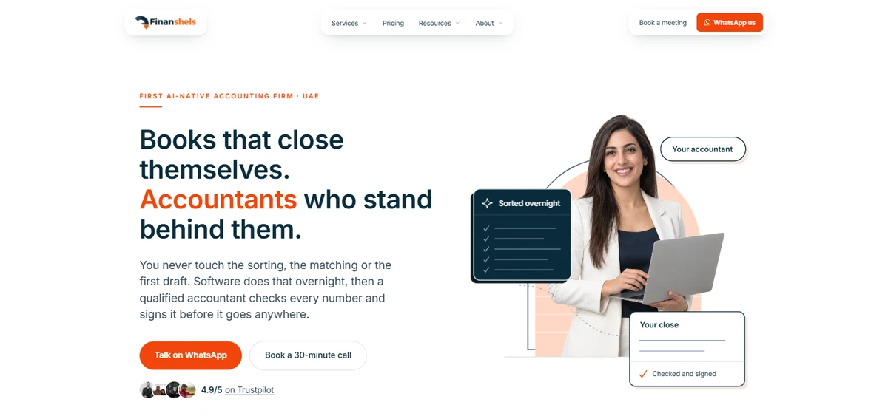
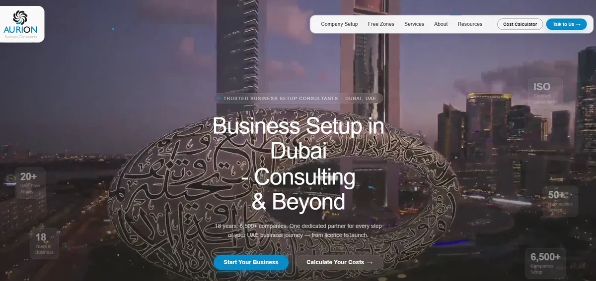
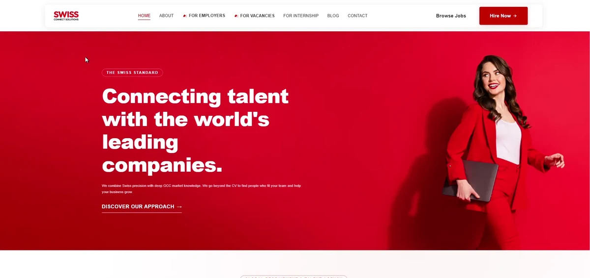
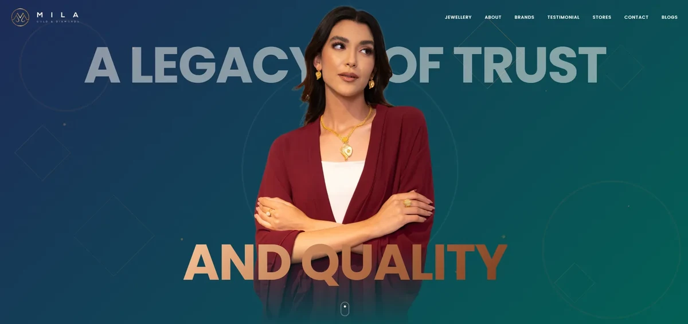
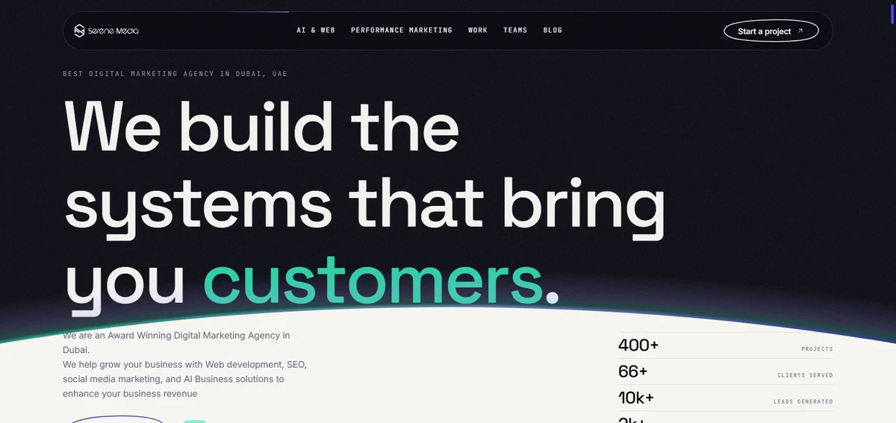
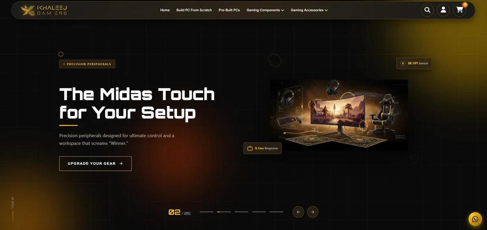

### Hi, I'm Ghaleb

I build websites, CMSs and AI assistants for businesses in the UAE, and 3D web experiences in three.js. Most of that client code is private, so below is the work as it runs in production. My public repos are further down.

[Portfolio](https://ghalebmohiuddinsyed.com) · [LinkedIn](https://www.linkedin.com/in/ghalebmohiuddinsyed/)

 

<table>
<tr>
<td width="50%" valign="top">

 <b>Finanshels</b> · Live link on request · launch in progress
 Marketing site and page-builder CMS for a UAE accounting firm, so its marketers publish pages without a developer.
</td>
<td width="50%" valign="top">

 <b>Aurion</b> · <a href="https://aurionuae.com">aurionuae.com</a>
 Website for a UAE business-setup consultancy, with an AI assistant that captures about 20 leads a month, a cost calculator with PDF quotes and an admin dashboard.
</td>
</tr>
<tr>
<td width="50%" valign="top">

 <b>Swiss Connect</b> · <a href="https://swissconnect.ae">swissconnect.ae</a>
 Redesign for a Dubai HR and recruitment agency, with an AI assistant that answers from the site's own content and captures leads.
</td>
<td width="50%" valign="top">

 <b>Mila Gold &amp; Diamonds</b> · <a href="https://milagoldanddiamonds.com">milagoldanddiamonds.com</a>
 Motion-led website for a UAE jewellery brand, with GSAP scroll animation synced to smooth scrolling.
</td>
</tr>
<tr>
<td width="50%" valign="top">

 <b>serenemedia.io</b> · <a href="https://serenemedia.io">serenemedia.io</a>
 Scroll-driven site for a Dubai marketing and web agency, where project panels climb a 3D helix as you scroll.
</td>
<td width="50%" valign="top">

 <b>Khaleej Gamers</b> · <a href="https://khaleejgamers.ae">khaleejgamers.ae</a>
 Shopify store for a gaming-PC brand, with a PC builder that checks CPU socket, RAM type and power-supply wattage before you buy.
</td>
</tr>
</table>

<!-- Fact IDs: FIN-01/FIN-24, AUR-06/AUR-14/AUR-15/AUR-19, SWC-04/SWC-13, MIL-10, SER-06, KHG-03 -->
